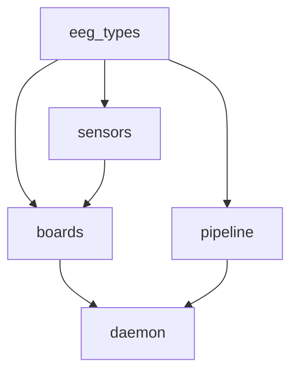
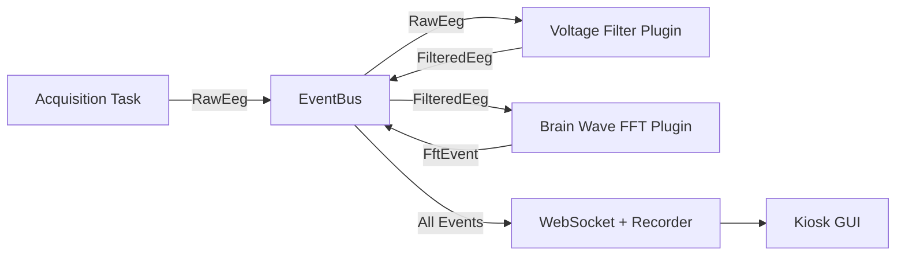

<a id="crate-architecture"></a>

## 板条箱架构

固件是一个 Rust 工作区，分为五个严格分层的板条箱。没有循环依赖。



| 板条箱 | 拥有 | 取决于 |
| ------------- | ----------------------------------------------------------------------- | --------------------------- |
| **eeg_types** | `Packet`、 `ChannelId`、 `AdcConfig`、错误枚举 | — |
| **传感器** | 单芯片的寄存器映射、低级 SPI/I2C | 脑电图类型 |
| **板** | 将一个或多个芯片粘合到 PCB 驱动器中的胶水 (`impl EegDriver`) | 传感器，eeg_types |
| **管道** | DSP 图、处理阶段、接收器 | 脑电图类型 |
| **守护进程** | CLI、配置、选择板驱动程序并将数据包泵入管道 | 板、管道、eeg_types |

守护进程是唯一的二进制包。其他一切都是图书馆。

---

<a id="plugin-system"></a>

## 插件系统

插件是事件驱动的，并且跨 CPU 内核并行运行。每个插件都是 `plugins/` 目录中的一个单独的 Rust 箱。



<a id="writing-a-plugin"></a>

### 编写插件

每个插件都实现了 `EegPlugin` 特征：

```rust
#[async_trait]
impl EegPlugin for MyPlugin {
    fn name(&self) -> &'static str { "my_plugin" }
    fn clone_box(&self) -> Box<dyn EegPlugin> { Box::new(self.clone()) }

    async fn run(
        &mut self,
        bus: Arc<dyn EventBus>,
        mut receiver: broadcast::Receiver<SensorEvent>,
        shutdown_token: CancellationToken,
    ) -> Result<()> {
        loop {
            tokio::select! {
                biased;
                _ = shutdown_token.cancelled() => break,
                Ok(event) = receiver.recv() => {
                    // process event, then broadcast results back to bus
                }
            }
        }
        Ok(())
    }
}
```

插件可以选择声明 `event_filter` 来仅订阅相关事件类型，避免不必要的唤醒。

<a id="included-plugins"></a>

### 包含的插件

| 插件 | 目的 |
| ---------------------- | ------------------------------------------ |
| `basic_voltage_filter` | 电压缩放和滤波 |
| `brain_waves_fft` | 使用浏览器 UI 进行 FFT 频谱分解 |
| `csv_recorder` | 将会话记录到 CSV 文件 |

---

## WebSocket API

该守护进程公开了一个集中式 WebSocket 端点，用于通过基于主题的发布/订阅模型进行实时数据流。

**端点：** `ws://localhost:9000/ws/data`

<a id="subscribe-to-a-topic"></a>

### 订阅主题

```json
{ "type": "subscribe", "topic": "eeg_voltage", "epoch": 1 }
```

<a id="unsubscribe"></a>

### 退订

```json
{ "type": "unsubscribe", "topic": "eeg_voltage" }
```

数据帧是二进制的（`RtPacket` 格式），用于高性能流。单个客户端可以同时持有多个主题订阅。

<a id="control-plane-rest--sse"></a>

### 控制平面（REST + SSE）

除了 WebSocket 数据平面之外，守护进程还在同一端口上提供 HTTP 端点：

| 端点 | 方法 | 目的 |
| ----------------------------- | ------ | ------------------------------------------- |
| `/api/pipelines` | 获取 | 列出可用的管道定义 |
| `/api/pipelines/{id}/start` | 后处理 | 启动管道 |
| `/api/pipeline/stop` | 后处理 | 停止正在运行的管道 |
| `/api/state` | 获取 | 当前运行时配置快照 |
| `/api/events` | 获取 | SSE 状态更新流 |
| `/api/pipelines/{id}/control` | 后处理 | 发送运行时命令（例如 `SetParameter`） |

---

<a id="board-configurations"></a>

## 主板配置

<a id="v1-single-ads1299"></a>

### V1：单ADS1299

一个 ADS1299 EVM 通过 SPI 直接连接到 Pi 5。提供 8 个通道，带缓冲参考 (SRB1) 和固定内部偏置驱动。

| SPI信号 | ADS1299 引脚 (J3) | 树莓派 5 针 |
| ----------- | ---------------- | --------------- |
| 计算机科学 | 引脚 1 | 引脚 24 (CE0) |
| 时钟时钟 | 引脚 3 | 针脚 23 |
| 莫西 (DIN) | 引脚 11 | 针脚 19 |
| 味噌 (DOUT) | 针脚 13 | 针脚 21 |
| DRDY | 引脚 15 | 引脚 22 (GPIO25) |

<a id="v2-four-synchronized-ads1299-boards"></a>

### V2：四块同步 ADS1299 板

星形拓扑，其中一个主板和三个辅助板共享时钟、MOSI、SCLK 和 MISO。每个板都有专用的片选和 DRDY 线。只有主板（板 0）驱动偏置电极。

| 信号 | 树莓派 5 针 | 说明 |
| ------------------ | --------------- | ---------------------- |
| CS_A（板0） | 引脚 24 (CE0) | 硬件CS |
| CS_B（板1） | 引脚 26 (CE1) | 硬件CS |
| CS_C（板2） | 引脚 29 (GPIO5) | 软件CS |
| CS_D（板 3） | 引脚 31 (GPIO6) | 软件CS |
| 开始（所有板） | 引脚 15 (GPIO22) | 同步脉冲 |
| DRDY（板 0） | 引脚 22 (GPIO25) | 下降沿中断 |

---

<a id="next"></a>

## 下一步

<CardGroup cols={2}>
  <Card icon="brain" href="/cn/home/elata-eeg/elata-eeg-overview" title="EEG 概述">
硬件 BOM 和快速入门
  </Card>
  <Card icon="bluetooth" href="/cn/sdk/eeg-web-ble/getting-started" title="SDK： EEG 网页">
通过网络蓝牙连接到 EEG 头带
  </Card>
</CardGroup>