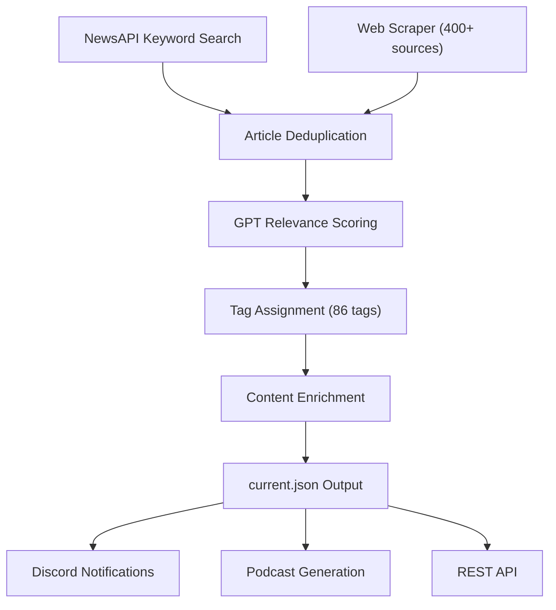

<a id="system-architecture"></a>

## 系统架构

新闻阅读器由三个模块组成：

```
elata-vsm-system-4/
├── scraper/         # AI-powered news aggregation engine
├── web/             # Next.js frontend
└── shared-types/    # Zod schemas and shared TypeScript types
```

---

<a id="scraper-pipeline"></a>

## 刮板管道

刮刀通过 PM2 按计划进程运行。每个周期执行以下管道：



<a id="phase-1-aggregation"></a>

### 第一阶段：聚合

- **NewsAPI** 神经科学、精神病学、BCI、DeSci 和相关关键字的查询
- **网络抓取** 从 400 多个精选来源获取：期刊、预印本服务器、制药商店、神经科技公司、监管机构和社区平台

<a id="phase-2-analysis"></a>

### 第二阶段：分析

- **GPT 处理器** 根据 Elata 任务评估每篇文章并分配相关性分数 (0-1)
- **GPT 验证器** 过滤掉低质量或不相关的内容
- **标签分配** 适用于跨类别的 86 个特定领域标签的受控词汇表：神经科学、硬件、AI/ML、药理学、生物黑客、生物标记、DeSci 和工业

<a id="phase-3-enrichment-and-output"></a>

### 第三阶段：丰富和输出

- **内容抓取** 提取全文、字数和阅读时间
- **嵌入生成** 通过 OpenAI 用于语义搜索
- **播客生成** 使用 ElevenLabs 和两个叙述者角色（Nova 和 Dr. Renn）生成 AI 叙述的音频摘要
- **不和谐通知** 提醒社区高相关性文章
- 结果写入 `current.json` 并通过 REST API 提供服务

---

<a id="data-model"></a>

## 数据模型

文章遵循 Zod 验证的架构：

```typescript
const ArticleSchema = z.object({
  id: z.string(),
  title: z.string(),
  url: z.string(),
  source: z.string(),
  description: z.string(),
  summary: z.string().optional(),
  tags: z.array(NewsTagSchema).default([]),
  relevanceScore: z.number(),
  author: z.string().optional(),
  publishedAt: z.string().optional(),
  scrapedAt: z.string(),
  sourceType: z.enum(["newsapi", "scrape", "twitter", "reddit", "community"]).optional(),
  embedding: z.array(z.number()).optional(),
  // ... additional fields
});
```

摘要元数据跟踪聚合统计数据：

```typescript
const SummaryMetadataSchema = z.object({
  totalArticles: z.number(),
  dateRange: z.object({ from: z.string(), to: z.string() }),
  tagCounts: z.record(z.string(), z.number()),
  sourceCounts: z.record(z.string(), z.number()),
});
```

---

<a id="tag-taxonomy"></a>

## 标签分类

这 86 个标签被组织成域：

| 域名 | 标签计数 | 示例 |
|--------|-----------|---------|
| 神经科学研究 | 15 | `eeg`, `fmri`, `neuroimaging`, `synaptic-plasticity` |
| 硬件与设备 | 16 | `bci`, `neural-interfaces`, `openbci`, `muse`, `eeg-headsets` |
| 计算与人工智能 | 12 | `precision-psychiatry`, `machine-learning`, `neural-decoding` |
| 神经药理学 | 8 | `neuropharmacology`, `clinical-trials`, `drug-discovery` |
| 生物黑客与实验 | 12 | `nootropics`, `psychedelics`, `neurofeedback`, `meditation` |
| 生物标志物和机制 | 10 | `biomarkers`, `neuroinflammation`, `gut-brain-axis` |
| 德科学与Web3 | 7 | `desci`, `daos`, `tokenomics`, `on-chain-governance` |
| 工业与商业 | 6 | `pharma`, `biotech`, `startups`, `regulatory` |

---

<a id="running-locally"></a>

## 本地运行

```bash
git clone https://github.com/Elata-Biosciences/elata-vsm-system-4.git
cd elata-vsm-system-4
```

请参阅各个模块自述文件进行设置：
- [刮刀设置](https://github.com/Elata-Biosciences/elata-vsm-system-4/tree/main/scraper)
- [Web 平台设置](https://github.com/Elata-Biosciences/elata-vsm-system-4/tree/main/web)
