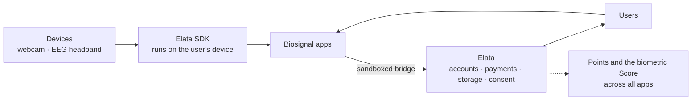

## 大局观

Elata 有四层。这些文档中的每个部分都有自己的部分。

---

## 1. 设备

传感器是人们已经拥有的东西：

- **网络摄像头** 可以根据皮肤微小的颜色变化来估计脉搏（远程光电体积描记法，或 rPPG）。
- **消费者 EEG 头带**，例如 Muse 2 或 Muse S，从头皮上的几个点测量电活动，某些型号还具有光学 (PPG) 心率传感器。

请参阅 [您可以使用的设备](/cn/users/devices) ，以及，对于科学而言， [生物信号解释](/cn/overview/biosignals)。

---

## 2.Elata SDK

 [Elata SDK](/cn/overview/elata-sdk) 是一组开源软件包，可连接到这些设备并将原始信号转换为可用的测量值，例如心率、心率变异性和 EEG 频段功率。使用 WebAssembly在用户设备上的浏览器中运行处理。构建者使用 SDK，因此他们不必从头开始编写信号处理。

---

## 3. 应用程序

开发者将 SDK 与他们自己的想法相结合：您可以专注或平静地驾驶游戏、跟随您的心率的呼吸指南、实时仪表板、研究工具。应用程序是普通的网络应用程序。请参阅 Elata 上的 [应用程序](/cn/overview/apps-on-elata)。

---

## 4. Elata

[Elata](https://app.elata.bio) 是这些应用程序所在的位置。它：

- **评论** 每个版本（自动安全扫描加上人工审核）
- **主机** 每个应用程序都位于隔离的沙箱中，因此应用程序无法查看用户是谁或触摸他们的帐户
- **提供** 登录、购买、订阅和保存进度，因此构建者无需
- **在派生的会话结果贡献给平台生物识别分数之前，在其自己的界面中请求同意** 

---

## 跨所有应用程序

Elata 上的每个应用程序都有两件事：

- **[Elata 积分](/cn/overview/points)** 参与奖励：玩、评论、建造、邀请好友。
- **生物识别得分** 是一项可选的跨应用衡量标准，仅根据派生的会话结果构建，并且仅在用户选择加入的情况下进行。请参阅 [隐私和同意](/cn/overview/privacy-and-consent)。

---

## 价值如何变动

| 谁 | 给予 | 获取 |
| --- | --- | --- |
| 用户 | 注意、反馈、可选购买 | 对身体做出反应并内置隐私的应用程序 |
| 建设者 | 应用程序 | 分发、内置帐户和付款以及购买和订阅的收入 |
| Elata | 平台及SDK | 每个应用程序的一次性注册费以及销售和订阅的平台费 |

详细信息： [货币化](/cn/overview/monetization)。

---

## 数据所在的地方

| 数据 | 它停留在哪里 |
| --- | --- |
| 原始相机帧和生物信号 | 在用户的设备上 |
| 保存、设置应用程序商店并对其进行评分 | 用户的帐户，范围仅限于该一个应用程序 |
| 得出的得分会话结果 | 仅在用户同意的情况下与 Elata 共享 |
| 建设者看到了什么 | 聚合使用分析；商务报告还可以显示缩短的买家钱包和交易链接 |
