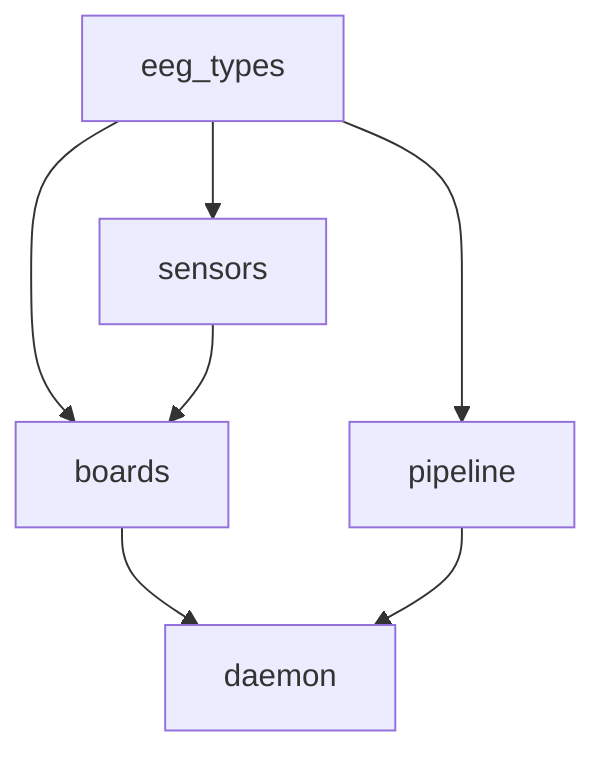
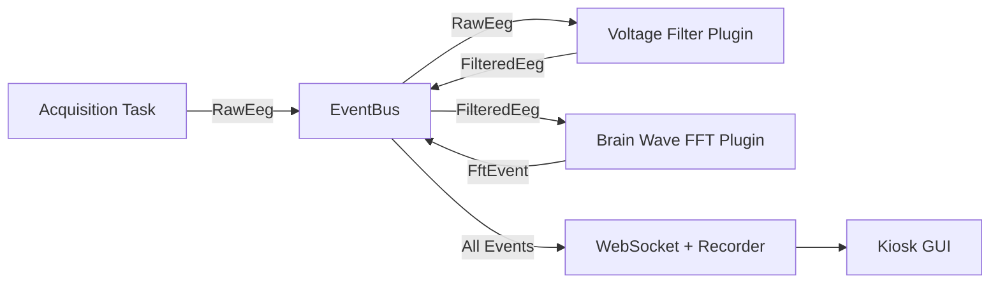

<a id="crate-architecture"></a>

## Arquitectura de cajas

El firmware es un espacio de trabajo de Rust dividido en cinco cajas con capas estrictas. Sin dependencias circulares.



| caja | posee | Depende de |
| ------------- | ----------------------------------------------------------------------- | --------------------------- |
| **eeg_types** | `Packet`, `ChannelId`, `AdcConfig`, enumeraciones de error | — |
| **sensores** | Registro de mapas, SPI/I2C de bajo nivel para un solo chip | tipos_eeg |
| **tableros** | Pegamento que une uno o más chips en un controlador de PCB (`impl EegDriver`) | sensores, tipos_eeg |
| **tubería** | Gráfico DSP, etapas de procesamiento, sumideros. | tipos_eeg |
| **demonio** | CLI, configuración, selecciona un controlador de placa y bombea paquetes a la tubería | tableros, tuberías, eeg_types |

El demonio es la única caja binaria. Todo lo demás es una biblioteca.

---

<a id="plugin-system"></a>

## Sistema de complementos

Los complementos se controlan por eventos y se ejecutan en paralelo en todos los núcleos de la CPU. Cada complemento es una caja Rust separada en el directorio `plugins/` .



<a id="writing-a-plugin"></a>

### Escribir un complemento

Cada complemento implementa el rasgo `EegPlugin` :

```rust
#[async_trait]
impl EegPlugin for MyPlugin {
    fn name(&self) -> &'static str { "my_plugin" }
    fn clone_box(&self) -> Box<dyn EegPlugin> { Box::new(self.clone()) }

    async fn run(
        &mut self,
        bus: Arc<dyn EventBus>,
        mut receiver: broadcast::Receiver<SensorEvent>,
        shutdown_token: CancellationToken,
    ) -> Result<()> {
        loop {
            tokio::select! {
                biased;
                _ = shutdown_token.cancelled() => break,
                Ok(event) = receiver.recv() => {
                    // process event, then broadcast results back to bus
                }
            }
        }
        Ok(())
    }
}
```

Opcionalmente, los complementos pueden declarar un `event_filter` para suscribirse solo a tipos de eventos relevantes, evitando reactivaciones innecesarias.

<a id="included-plugins"></a>

### Complementos incluidos

| Complemento | Propósito |
| ---------------------- | ------------------------------------------ |
| `basic_voltage_filter` | Escalado y filtrado de tensión. |
| `brain_waves_fft` | Descomposición espectral FFT con la interfaz de usuario del navegador |
| `csv_recorder` | Grabar sesiones en archivos CSV |

---

<a id="websocket-api"></a>

## API WebSocket

El demonio expone un punto final WebSocket centralizado para la transmisión de datos en tiempo real con un modelo de publicación/subversión basado en temas.

**Punto final:** `ws://localhost:9000/ws/data`

<a id="subscribe-to-a-topic"></a>

### Suscríbete a un tema

```json
{ "type": "subscribe", "topic": "eeg_voltage", "epoch": 1 }
```

<a id="unsubscribe"></a>

### Darse de baja

```json
{ "type": "unsubscribe", "topic": "eeg_voltage" }
```

Los marcos de datos son binarios (formato`RtPacket` ) para transmisión de alto rendimiento. Un único cliente puede tener varias suscripciones a temas simultáneamente.

<a id="control-plane-rest--sse"></a>

### Plano de control (REST + SSE)

Además del plano de datos WebSocket, el demonio proporciona puntos finales HTTP en el mismo puerto:

| Punto final | Método | Propósito |
| ----------------------------- | ------ | ------------------------------------------- |
| `/api/pipelines` | OBTENER | Listar definiciones de canalización disponibles |
| `/api/pipelines/{id}/start` | PUBLICAR | Iniciar una tubería |
| `/api/pipeline/stop` | PUBLICAR | Detener la tubería en ejecución |
| `/api/state` | OBTENER | Instantánea de la configuración del tiempo de ejecución actual |
| `/api/events` | OBTENER | Flujo de actualizaciones estatales de SSE |
| `/api/pipelines/{id}/control` | PUBLICAR | Enviar comandos de tiempo de ejecución (por ejemplo, `SetParameter`) |

---

<a id="board-configurations"></a>

## Configuraciones de la placa

<a id="v1-single-ads1299"></a>

### V1: ADS1299 único

Un EVM ADS1299 conectado directamente al Pi 5 a través de SPI. Proporciona 8 canales con referencia amortiguada (SRB1) y unidad de polarización interna fija.

| Señal SPI | ADS1299 Pasador (J3) | Pi 5 pines |
| ----------- | ---------------- | --------------- |
| CS | Pin 1 | Patilla 24 (CE0) |
| SCLK | Patilla 3 | Patilla 23 |
| MOSI (DIN) | Patilla 11 | Patilla 19 |
| MISO (DOUT) | Patilla 13 | Pin 21 |
| DRDY | Patilla 15 | Pin 22 (GPIO25) |

<a id="v2-four-synchronized-ads1299-boards"></a>

### V2: Cuatro placas ADS1299 sincronizadas

Topología en estrella con una placa maestra y tres secundarias que comparten reloj, MOSI, SCLK y MISO. Cada placa tiene una línea DRDY y selección de chip dedicada. Sólo la placa maestra (Placa 0) controla el electrodo de polarización.

| señal | Pi 5 pines | Notas |
| ------------------ | --------------- | ---------------------- |
| CS_A (Tablero 0) | Patilla 24 (CE0) | Hardware CS |
| CS_B (Tablero 1) | Pasador 26 (CE1) | Hardware CS |
| CS_C (Tablero 2) | Pin 29 (GPIO5) | software de informática |
| CS_D (Tablero 3) | Pin 31 (GPIO6) | software de informática |
| INICIO (todos los tableros) | Patilla 15 (GPIO22) | Pulso de sincronización |
| DRDY (Tablero 0) | Pin 22 (GPIO25) | Interrupción de flanco descendente |

---

<a id="next"></a>

## Siguiente

<CardGroup cols={2}>
  <Card icon="brain" href="/es/home/elata-eeg/elata-eeg-overview" title="EEG Descripción general">
Lista de materiales de hardware e inicio rápido
  </Card>
  <Card icon="bluetooth" href="/es/sdk/eeg-web-ble/getting-started" title="SDK: EEG Web">
Conéctese a diademas EEG a través de Web Bluetooth
  </Card>
</CardGroup>