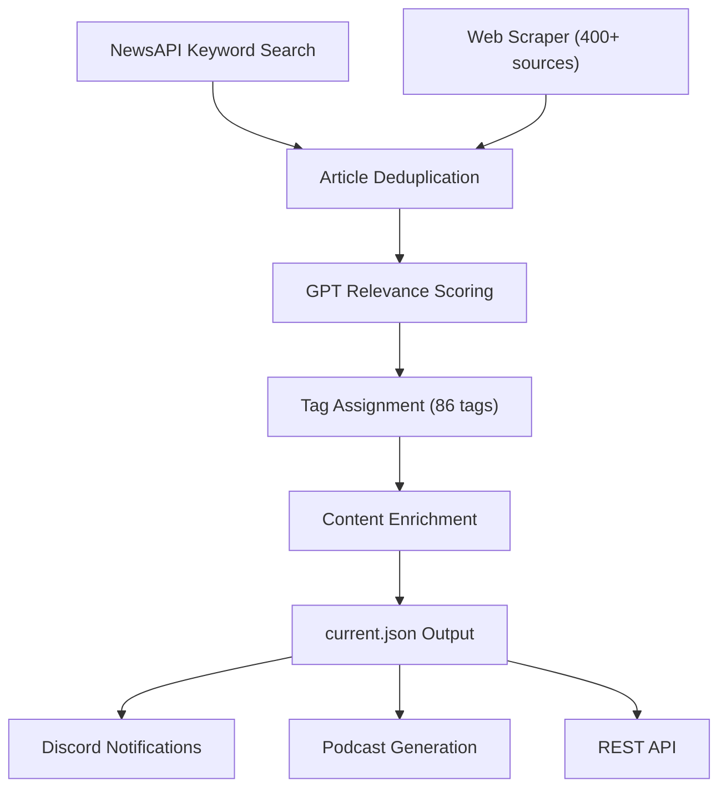

<a id="system-architecture"></a>

## Arquitectura del sistema

El Lector de Noticias se compone de tres módulos:

```
elata-vsm-system-4/
├── scraper/         # AI-powered news aggregation engine
├── web/             # Next.js frontend
└── shared-types/    # Zod schemas and shared TypeScript types
```

---

<a id="scraper-pipeline"></a>

## Tubería raspadora

El raspador se ejecuta como un proceso programado a través de PM2. Cada ciclo ejecuta la siguiente canalización:



<a id="phase-1-aggregation"></a>

### Fase 1: Agregación

- **NewsAPI** consultas de neurociencia, psiquiatría, BCI, DeSci y palabras clave relacionadas
- **Web scraper** obtiene de más de 400 fuentes seleccionadas: revistas, servidores de preimpresión, establecimientos farmacéuticos, empresas de neurotecnología, agencias reguladoras y plataformas comunitarias

<a id="phase-2-analysis"></a>

### Fase 2: Análisis

- **Procesador GPT** evalúa cada artículo según la misión de Elata y asigna una puntuación de relevancia (0-1)
- **Validador GPT** filtra contenido irrelevante o de baja calidad
- **La asignación de etiquetas** se aplica desde un vocabulario controlado de 86 etiquetas específicas de dominio en todas las categorías: neurociencia, hardware, IA/ML, farmacología, biohacking, biomarcadores, DeSci e industria.

<a id="phase-3-enrichment-and-output"></a>

### Fase 3: Enriquecimiento y Resultados

- **Raspador de contenido** extrae el texto completo, el recuento de palabras y el tiempo de lectura
- **Generación de incrustación** mediante OpenAI para búsqueda semántica
- **Generación de podcasts** produce resúmenes de audio narrados por IA utilizando ElevenLabs con dos narradores (Nova y Dr. Renn)
- **Notificaciones de Discord** alertan a la comunidad sobre artículos de alta relevancia
- Los resultados se escriben en `current.json` y se entregan a través de la API REST

---

<a id="data-model"></a>

## Modelo de datos

Los artículos siguen un esquema validado por Zod:

```typescript
const ArticleSchema = z.object({
  id: z.string(),
  title: z.string(),
  url: z.string(),
  source: z.string(),
  description: z.string(),
  summary: z.string().optional(),
  tags: z.array(NewsTagSchema).default([]),
  relevanceScore: z.number(),
  author: z.string().optional(),
  publishedAt: z.string().optional(),
  scrapedAt: z.string(),
  sourceType: z.enum(["newsapi", "scrape", "twitter", "reddit", "community"]).optional(),
  embedding: z.array(z.number()).optional(),
  // ... additional fields
});
```

Los metadatos de resumen rastrean estadísticas agregadas:

```typescript
const SummaryMetadataSchema = z.object({
  totalArticles: z.number(),
  dateRange: z.object({ from: z.string(), to: z.string() }),
  tagCounts: z.record(z.string(), z.number()),
  sourceCounts: z.record(z.string(), z.number()),
});
```

---

<a id="tag-taxonomy"></a>

## Taxonomía de etiquetas

Las 86 etiquetas están organizadas en dominios:

| Dominio | Recuento de etiquetas | Ejemplos |
|--------|-----------|---------|
| Neurociencia e investigación | 15 | `eeg`, `fmri`, `neuroimaging`, `synaptic-plasticity` |
| Hardware y dispositivos | 16 | `bci`, `neural-interfaces`, `openbci`, `muse`, `eeg-headsets` |
| Computacional e IA | 12 | `precision-psychiatry`, `machine-learning`, `neural-decoding` |
| Neurofarmacología | 8 | `neuropharmacology`, `clinical-trials`, `drug-discovery` |
| Biohacking y experimentación | 12 | `nootropics`, `psychedelics`, `neurofeedback`, `meditation` |
| Biomarcadores y mecanismos | 10 | `biomarkers`, `neuroinflammation`, `gut-brain-axis` |
| DeSci y Web3 | 7 | `desci`, `daos`, `tokenomics`, `on-chain-governance` |
| Industria y Negocios | 6 | `pharma`, `biotech`, `startups`, `regulatory` |

---

<a id="running-locally"></a>

## Ejecutando localmente

```bash
git clone https://github.com/Elata-Biosciences/elata-vsm-system-4.git
cd elata-vsm-system-4
```

Consulte los archivos LÉAME del módulo individual para la configuración:
- [Configuración del raspador](https://github.com/Elata-Biosciences/elata-vsm-system-4/tree/main/scraper)
- [Configuración de plataforma web](https://github.com/Elata-Biosciences/elata-vsm-system-4/tree/main/web)
