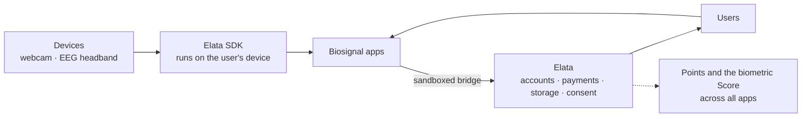

## El panorama general

Elata tiene cuatro capas. Cada uno tiene su propia sección en estos documentos.

---

## 1. Dispositivos

Los sensores son cosas que la gente ya posee:

- **Una cámara web** puede estimar el pulso a partir de pequeños cambios de color en la piel (fotopletismografía remota o rPPG).
- **Una EEG diadema**de consumo, como Muse 2 o Muse S, mide la actividad eléctrica desde algunos puntos del cuero cabelludo y algunos modelos también tienen un sensor óptico de frecuencia cardíaca (PPG).

Consulte [Dispositivos que puede utilizar](/es/users/devices) y, para fines científicos, [Explicación de las bioseñales](/es/overview/biosignals).

---

## 2. El SDK de Elata

El [Elata SDK](/es/overview/elata-sdk) es un conjunto de paquetes de código abierto que se conectan a esos dispositivos y convierten señales sin procesar en medidas utilizables como frecuencia cardíaca, variabilidad de la frecuencia cardíaca y potencias de banda EEG . El procesamiento se ejecuta en el navegador, en el dispositivo del usuario, usando WebAssembly. Los constructores utilizan el SDK para no tener que escribir el procesamiento de señales desde cero.

---

## 3. Aplicaciones

Los desarrolladores combinan el SDK con sus propias ideas: juegos que usted dirige con concentración o calma, guías de respiración que siguen su ritmo cardíaco, paneles en vivo, herramientas de investigación. Las aplicaciones son aplicaciones web normales. Consulte [Aplicaciones en Elata](/es/overview/apps-on-elata).

---

## 4. Elata

[Elata](https://app.elata.bio) es donde viven esas aplicaciones. Eso:

- **Reseñas** cada versión (un análisis de seguridad automatizado más un moderador humano)
- **Aloja** cada aplicación en un entorno aislado, por lo que una aplicación no puede ver quién es el usuario ni tocar su cuenta
- **Proporciona** inicio de sesión, compras, suscripciones y progreso guardado, para que los constructores no tengan que hacerlo
- **Solicita consentimiento** en su propia interfaz antes de que el resultado de una sesión derivada contribuya a la puntuación biométrica de la plataforma

---

## En todas las aplicaciones

Dos cosas abarcan cada aplicación en Elata:

- **[Puntos Elata](/es/overview/points)** recompensa por participar: jugar, revisar, construir e invitar amigos.
- **La puntuación biométrica** es una medida opcional entre aplicaciones creada solo a partir de los resultados de la sesión derivados y solo si el usuario acepta. Consulte [Privacidad y consentimiento](/es/overview/privacy-and-consent).

---

## Cómo se mueve el valor

| quien | da | Obtiene |
| --- | --- | --- |
| Usuarios | Atención, comentarios, compras opcionales. | Aplicaciones que responden a su cuerpo, con privacidad incorporada |
| Constructores | Aplicaciones | Distribución, cuentas y pagos integrados e ingresos por compras y suscripciones. |
| Elata | La plataforma y el SDK | Una tarifa única de registro por aplicación y una tarifa de plataforma sobre ventas y suscripciones. |

Detalles: [Monetización](/es/overview/monetization).

---

## Donde viven los datos

| Datos | donde se queda |
| --- | --- |
| Fotogramas de cámara sin procesar y bioseñales. | En el dispositivo del usuario |
| Guarda, configura y puntúa una tienda de aplicaciones. | La cuenta del usuario, limitada a esa aplicación. |
| Resultados de sesión derivados para la puntuación | Compartido con Elata sólo con el consentimiento del usuario. |
| Lo que ven los constructores | Análisis de uso agregado; Los informes comerciales también pueden mostrar billeteras de compradores y enlaces de transacciones acortados. |
