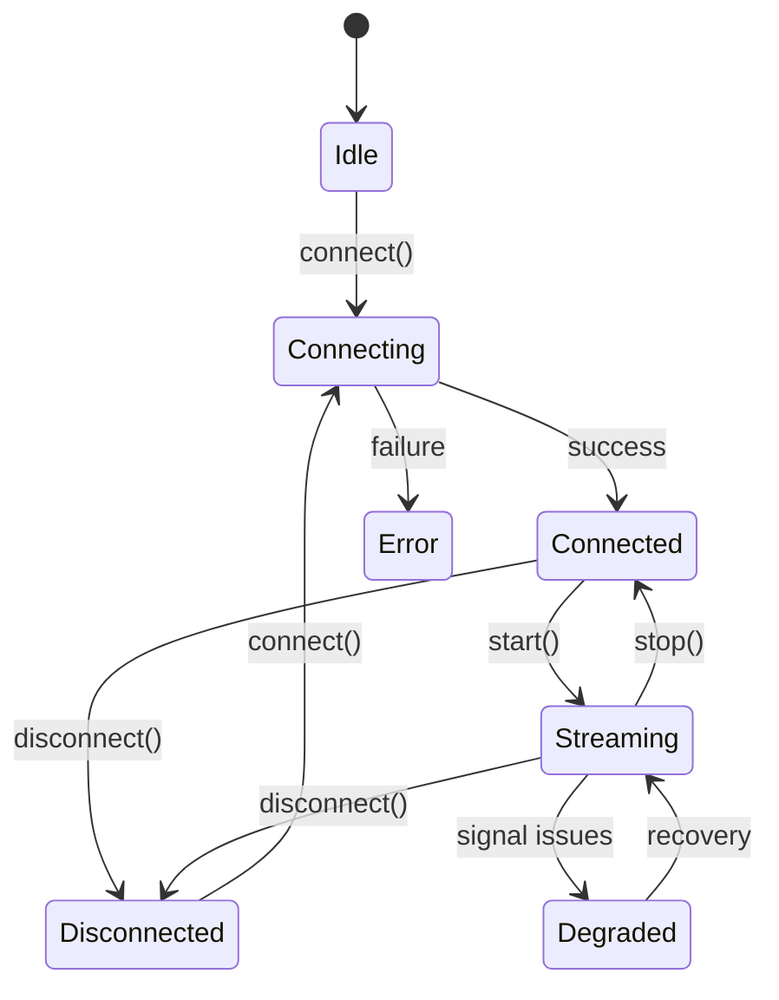

<a id="headbandframev1"></a>

## DiademaFrameV1

El marco de datos canónico emitido por todos los transportes de diadema. Cada implementación (BLE, puente nativo, sintética) produce esta misma forma:

```typescript
interface HeadbandFrameV1 {
  schemaVersion: "v1";
  source: string;                        // e.g., "muse-ble"
  sequenceId: number;
  emittedAtMs: number;
  eeg: HeadbandSignalBlock;              // always present
  ppgRaw?: HeadbandSignalBlock;          // PPG (if available)
  optics?: HeadbandSignalBlock;          // Athena optics
  accgyro?: HeadbandSignalBlock;         // Athena accelerometer/gyroscope
  battery?: HeadbandBatteryBlock;        // battery level
}
```

---

<a id="headbandsignalblock"></a>

## DiademaBloque de señal

Un bloque de muestras de series temporales para uno o más canales:

```typescript
interface HeadbandSignalBlock {
  sampleRateHz: number;
  channelNames: string[];                // e.g., ["TP9", "AF7", "AF8", "TP10"]
  channelCount: number;
  samples: number[][];                   // rows of [ch0, ch1, ch2, ch3]
  timestampsMs?: number[];
  clockSource?: "device" | "local";
}
```

---

<a id="headbandtransportstate"></a>

## Estado de transporte de diadema

Estados del ciclo de vida del transporte. `HeadbandTransportState` es una enumeración de cadena: `HeadbandTransportState.Streaming === "streaming"`.

| Estado | Descripción |
|-------|-------------|
| `Idle` | Transporte creado, no conectado |
| `Connecting` | Conexión en curso |
| `Connected` | Conectado, sin transmisión |
| `Streaming` | Recibiendo fotogramas activamente |
| `Degraded` | Conectado pero experimentando problemas |
| `Reconnecting` | Intentando volver a conectarse |
| `Disconnected` | Desconectado del dispositivo |
| `Error` | Error irrecuperable |

---

<a id="headbandtransport-interface"></a>

## Interfaz de transporte con diadema

Todos los transportes implementan esta interfaz:

```typescript
interface HeadbandTransport {
  onFrame?: (frame: HeadbandFrameV1) => void;
  onStatus?: (status: HeadbandTransportStatus) => void;
  connect(): Promise<void>;
  disconnect(): Promise<void>;
  start(): Promise<void>;
  stop(): Promise<void>;
}
```

**Ciclo de vida:**



---

<a id="headbandtransportstatus"></a>

## Estado de transporte de la diadema

Actualizaciones de estado emitidas a través de `onStatus`:

```typescript
interface HeadbandTransportStatus {
  state: HeadbandTransportState;
  atMs: number;
  reason?: string;
  errorCode?: string;
  recoverable?: boolean;
  details?: Record<string, unknown>;
}
```

---

<a id="usage-pattern"></a>

## Patrón de uso

```typescript
const transport: HeadbandTransport = /* BleTransport or other */;

transport.onFrame = (frame) => {
  const eegSamples = frame.eeg.samples;
  // samples[sampleIdx][channelIdx]: each row is one time step [tp9, af7, af8, tp10]
};

transport.onStatus = (status) => {
  console.log(`State: ${status.state}`, status.reason);
};

await transport.connect();
await transport.start();

// ... later
await transport.stop();
await transport.disconnect();
```

---

<a id="helpers"></a>

## Ayudantes

`@elata-biosciences/eeg-web` incluye ayudas para remodelar marcos:

| Ayudante | Devoluciones |
| --- | --- |
| `getEegChannelSamples(frame, channelIndex)` | Un canal como `Float32Array`, listo para `band_powers` |
| `getEegInterleavedSamples(frame)` | Todos los canales entrelazados `[s0_ch0, s0_ch1, …]`, para modelos como `WasmCalmnessModel` |
| `getEegSignalBlock(frame, source?)` | El bloque EEG crudo o procesado |

---

<a id="next"></a>

## Siguiente

<CardGroup cols={2}>
  <Card title="EEG Introducción a BLE" icon="bluetooth" href="/es/sdk/eeg-web-ble/getting-started">
Conexión a dispositivos de diadema
  </Card>
  <Card title="EEG + Integración BLE" icon="link" href="/es/sdk/guides/eeg-ble-integration">
Guía de transmisión de un extremo a otro
  </Card>
</CardGroup>
