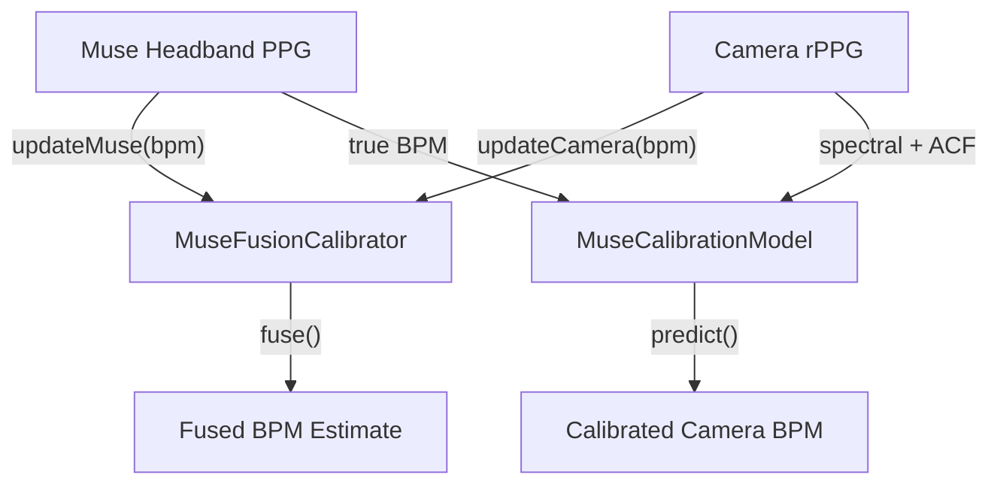

<a id="overview"></a>

## Información general

Cuando una diadema Muse con PPG está disponible junto con rPPGbasado en cámara, el SDK admite la fusión de sensores ****, utilizando el contacto PPG como referencia para calibrar y mejorar las estimaciones de frecuencia cardíaca basadas en cámara.

---

<a id="musefusioncalibrator"></a>

## MuseFusionCalibrador

Fusibles Muse PPG lecturas con cámara rPPG estimaciones para mejorar la precisión:

```typescript
import { RppgProcessor, MuseFusionCalibrator, loadWasmBackend } from "@elata-biosciences/rppg-web";

const backend = await loadWasmBackend(); // null if the packaged WASM can't be loaded
if (!backend) throw new Error("rPPG WASM backend unavailable");
const processor = new RppgProcessor(backend, 30);
const calibrator = new MuseFusionCalibrator();

// Feed Muse PPG readings (from headband)
calibrator.updateMuse(museBpm, quality, timestampMs);

// Feed camera rPPG readings
calibrator.updateCamera(cameraBpm, cameraQuality, timestampMs);

// Get fused result
const fused = calibrator.fuse(cameraBpm, cameraQuality, timestampMs);
```

El `RppgProcessor` también tiene una integración Muse incorporada:

```typescript
processor.updateMuseMetrics(museBpm, quality, timestampMs);
```

---

<a id="musecalibrationmodel"></a>

## MuseCalibraciónModelo

Un modelo de regresión simple que aprende la relación entre la cámara y el BPM de contacto a lo largo del tiempo:

```typescript
import { MuseCalibrationModel } from "@elata-biosciences/rppg-web";

const model = new MuseCalibrationModel();

// Train with paired observations
model.train(spectralBpm, acfBpm, trueBpm);

// Check if enough data collected
if (model.isTrained()) {
  const predictedBpm = model.predict(spectralBpm, acfBpm);
}

// Persistence
const snapshot = model.getSnapshot();
model.loadSnapshot(snapshot);
model.reset();
```

---

<a id="bpm-evidence-types"></a>

## Tipos de evidencia BPM

El procesador produce evidencia a partir de múltiples métodos de análisis:

```typescript
type BpmEvidenceSource = "backend" | "spectral" | "acf" | "peaks" | "calibrated";

type BpmEvidence = {
  source: BpmEvidenceSource;
  bpm: number;
  confidence: number;
};

type BpmResolutionResult = {
  bpm: number | null;
  confidence: number;
  winningSources: BpmEvidenceSource[];
  aliasFlag: boolean;
  debug: { /* candidates, history median, winner */ };
};

type FusionSource = "camera" | "muse" | "blend" | "none";
```

---

<a id="muse-ppg-filter"></a>

## Musa PPG Filtro

Aplique filtrado de paso de banda estilo Muse a PPG muestras:

```typescript
import { museStyleFilter } from "@elata-biosciences/rppg-web";

const filtered = museStyleFilter(ppgSamples, sampleRate);
```

---

<a id="calibration-workflow"></a>

## Flujo de trabajo de calibración



1. Comience con solo cámara rPPG
2. Cuando se conecta una diadema Muse, alimenta su PPG como verdad básica
3. El modelo de calibración aprende el mapeo de cámara a contacto.
4. Una vez entrenadas, las estimaciones realizadas únicamente con la cámara se corrigen utilizando el modelo aprendido.
5. El calibrador de fusión combina ambas fuentes para una máxima precisión

---

<a id="next"></a>

## Siguiente

<CardGroup cols={2}>
  <Card title="Fuentes de marco" icon="camera" href="/es/sdk/rppg-web/frame-sources">
Captura de cámara y detección de rostros.
  </Card>
  <Card title="rPPG Integración de cámara" icon="video" href="/es/sdk/guides/rppg-camera">
Canalización de cámaras web de extremo a extremo
  </Card>
</CardGroup>
